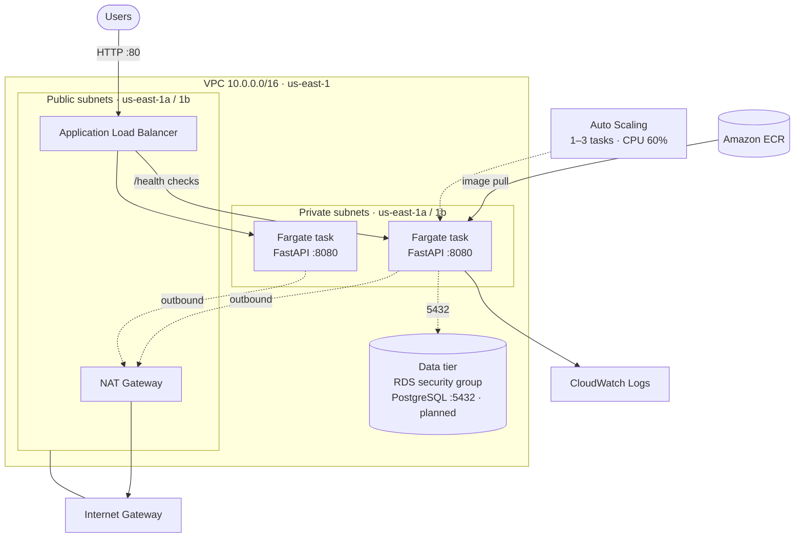
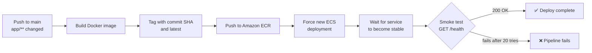

# ECS Fargate Three-Tier Deployment with Terraform and CI/CD

A containerized **FastAPI** service deployed on **AWS ECS Fargate** behind an **Application Load Balancer**, with all infrastructure defined in **Terraform** and every application change shipped automatically by a **GitHub Actions** pipeline.

The design follows a three-tier network layout: a public tier for the load balancer, a private application tier for the containers, and a locked-down data tier prepared for a PostgreSQL database.

---

## Architecture



**How traffic flows**

1. Users reach the **Application Load Balancer** in the public subnets on port 80.
2. The ALB forwards requests to **Fargate tasks** running in the private subnets on port 8080.
3. Tasks have **no public IPs**. They reach the internet (for example, to pull images) only through the **NAT Gateway**.
4. The ALB checks `/health` every 15 seconds and only sends traffic to healthy tasks.
5. Container logs stream to **CloudWatch Logs**.

---

## Security Design

Each tier only accepts traffic from the tier in front of it:

| Security group | Allows inbound | From |
|---|---|---|
| ALB | TCP 80 | The internet (`0.0.0.0/0`) |
| ECS tasks | TCP 8080 | The ALB security group only |
| RDS (data tier) | TCP 5432 | The ECS tasks security group only |

- Application containers run in **private subnets** with no public IP addresses.
- The ALB is the **only public entry point**.
- The ECS task execution role uses the AWS-managed `AmazonECSTaskExecutionRolePolicy`, which only covers pulling images and writing logs.
- ECR **scans images for vulnerabilities** on every push.

---

## Auto Scaling

The ECS service scales automatically using **target tracking** on average CPU:

| Setting | Value |
|---|---|
| Minimum tasks | 1 |
| Maximum tasks | 3 |
| CPU target | 60% |
| Scale-out cooldown | 60 seconds |
| Scale-in cooldown | 120 seconds |

When average CPU goes above 60%, AWS adds tasks (up to 3). When load drops, it removes them (down to 1). Terraform is set to ignore `desired_count` so it doesn't undo scaling decisions on the next `terraform apply`.

---

## CI/CD Pipeline



The workflow (`.github/workflows/deploy.yml`) only runs when files under `app/` or the workflow itself change, so documentation and infrastructure edits don't trigger a deployment. Images are tagged with the **commit SHA** so every deployment can be traced back to the exact code that produced it.

---

## Tech Stack

| Area | Technology |
|---|---|
| Application | Python 3.11, FastAPI, Uvicorn |
| Containers | Docker, Amazon ECR |
| Compute | Amazon ECS on AWS Fargate |
| Networking | VPC, public and private subnets across 2 AZs, Internet Gateway, NAT Gateway, route tables |
| Load balancing | Application Load Balancer, target group with health checks |
| Scaling | Application Auto Scaling (target tracking on CPU) |
| Observability | Amazon CloudWatch Logs (14-day retention) |
| Infrastructure as Code | Terraform with S3 remote state and DynamoDB state locking |
| CI/CD | GitHub Actions |

---

## API Endpoints

| Method | Endpoint | Description |
|---|---|---|
| `GET` | `/` | Confirms the service is running |
| `GET` | `/health` | Health check used by the ALB and the pipeline smoke test |
| `GET` | `/version` | Returns the `APP_VERSION` environment variable (defaults to `dev`) |
| `GET` | `/docs` | Interactive Swagger UI |

---

## Project Structure

```
ecs-three-tier-fastapi/
├── app/
│   ├── main.py                 # FastAPI application
│   ├── requirements.txt
│   └── Dockerfile
├── infra/envs/dev/
│   ├── backend.tf              # S3 remote state + DynamoDB locking
│   ├── provider.tf             # AWS provider and version pins
│   ├── variables.tf
│   ├── vpc.tf                  # VPC, Internet Gateway, public and private subnets
│   ├── routes.tf               # Public route table
│   ├── nat.tf                  # NAT Gateway and private route table
│   ├── security_groups.tf      # ALB, ECS tasks, and RDS security groups
│   ├── ecr.tf                  # Container registry
│   ├── ecs.tf                  # ECS cluster
│   ├── ecs_fargate.tf          # ALB, target group, task definition, service, IAM, logs
│   ├── autoscaling.tf          # Service auto scaling policy
│   └── outputs.tf
└── .github/workflows/
    └── deploy.yml              # Build → push → deploy → smoke test
```

---

## Deploying It Yourself

### Prerequisites

- An AWS account and the AWS CLI configured
- Terraform 1.5 or newer
- Docker
- An S3 bucket and DynamoDB table for Terraform state (names are set in `backend.tf`)

### 1. Provision the infrastructure

```bash
cd infra/envs/dev
terraform init
terraform plan
terraform apply
```

Terraform outputs the ALB DNS name, ECR repository URL, cluster name, and service name.

### 2. Push the first image

The service needs an image in ECR before tasks can start:

```bash
aws ecr get-login-password --region us-east-1 | \
  docker login --username AWS --password-stdin <ecr_repository_url>

docker build -t <ecr_repository_url>:latest ./app
docker push <ecr_repository_url>:latest
```

### 3. Configure the pipeline

Add these **repository secrets** in GitHub (**Settings → Secrets and variables → Actions**):

| Secret | Value |
|---|---|
| `AWS_ACCESS_KEY_ID` | Access key for a deployment IAM user |
| `AWS_SECRET_ACCESS_KEY` | Secret for that key |
| `AWS_REGION` | `us-east-1` |
| `ECR_REPOSITORY` | `ecs-three-tier-fastapi` |
| `ECS_CLUSTER` | `ecs-three-tier-dev-cluster` |
| `ECS_SERVICE` | `ecs-three-tier-fastapi-svc` |

From then on, every push that changes `app/` deploys automatically.

### 4. Test it

```bash
curl http://<alb_dns_name>/health
# {"status":"healthy"}
```

### 5. Clean up

The NAT Gateway and load balancer are billed by the hour, so destroy the stack when you're done:

```bash
terraform destroy
```

---

## What I Learned

- Designing a VPC with **public and private subnets across two Availability Zones** for high availability
- Keeping workloads private while still allowing outbound access through a **NAT Gateway**
- Chaining **security groups** so each tier only trusts the tier in front of it
- Managing **Terraform state remotely** with S3 and DynamoDB locking so it's safe to run from more than one place
- Building a **deployment pipeline** that verifies the release with a smoke test instead of assuming success
- Configuring **auto scaling** and preventing Terraform from fighting scaling decisions

---

## Roadmap

- [ ] Add an Amazon RDS PostgreSQL instance in the data tier
- [ ] Switch the pipeline from access keys to **GitHub OIDC** for short-lived AWS credentials
- [ ] Add HTTPS with an ACM certificate and redirect HTTP to HTTPS
- [ ] Add CloudWatch alarms and a dashboard for latency, errors, and task count
- [ ] Split Terraform into reusable modules and add a `prod` environment
- [ ] Add blue/green deployments with AWS CodeDeploy

---

## Author

**Paul Momo** · [GitHub](https://github.com/mopaul873)
